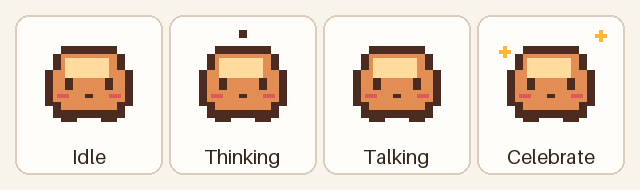

# Sprite Companion

A reusable animated character with optional chat. The demo includes Mochi, an original pixel sprite with idle, thinking, talking and celebration animations.



The web demo uses vanilla JavaScript and Node.js 20.12 or newer. It has no npm dependencies. The sprite renderer can run on a static site, and the chat API can be reused by a website, desktop app or game.

## Run the demo

From the folder containing this README:

```bash
npm start
```

Open [http://127.0.0.1:3000](http://127.0.0.1:3000). Use the animation buttons to preview Mochi. Send a message with the Send button or Ctrl/Command + Enter. With no AI configuration, the chat returns a fallback message.

## Enable AI with Ollama

1. [Install Ollama](https://ollama.com/download) and launch it. If you installed just the CLI and the service is stopped, run `ollama serve` in a separate terminal.
2. Download the local model, copy the sample settings and restart the demo.

```bash
ollama pull qwen3:4b
cp .env.example .env
npm start
```

Local inference with Ollama has no per-token API charge. The model runs on your hardware after download, so model size, storage, RAM and response time still matter. The project defaults to `qwen3:4b`. To try the lighter `qwen3:1.7b`, pull it, set `AI_MODEL=qwen3:1.7b` in `.env`, and restart. Hosted providers may have separate fees, quotas and data policies. See the [Ollama local FAQ](https://docs.ollama.com/faq) and [Qwen3 model tags](https://ollama.com/library/qwen3).

## Use a different provider

| Mode | Settings |
| --- | --- |
| Local Ollama | `AI_PROVIDER=ollama`, `AI_MODEL=qwen3:4b`. The default base URL is `http://127.0.0.1:11434`. |
| OpenAI-compatible chat API | `AI_PROVIDER=openai-compatible`, `AI_BASE_URL` including the provider’s API prefix, typically `/v1`, and `AI_MODEL` set to the provider’s model ID. Add `AI_API_KEY` if required. |
| Animations and fallback chat | `AI_PROVIDER=off` or start without an `.env`. |

For a service that uses a different protocol, add a provider in [src/chat.js](src/chat.js) and keep the response shape `{ reply, source }`. Keep provider keys in server settings. See the [integration guide](docs/integration.md) for the full API and deployment notes.

## Use your own character

1. Export your character as transparent PNG or WebP. A single image works with a one-frame `idle` clip.
2. Put the image files under `public/sprites/` and copy [mochi.json](public/sprites/mochi.json) as a starting point.
3. Set `data-manifest` in [public/index.html](public/index.html) to your manifest. Edit [src/profile.js](src/profile.js) for the name the AI uses, its personality, its role and any facts it needs.

The same sprite can work across AI providers, and the same chat can work with different sprites. See the [sprite guide](docs/sprites.md) for grid sizing and optional animations.

## Tests

Run `npm test` for the sprite and chat checks. GitHub Actions runs the same checks on Node.js 20 and 22.

Your personal `.env` stays on your machine and is ignored by Git. Commit `.env.example` instead.

## License

[MIT](LICENSE).
